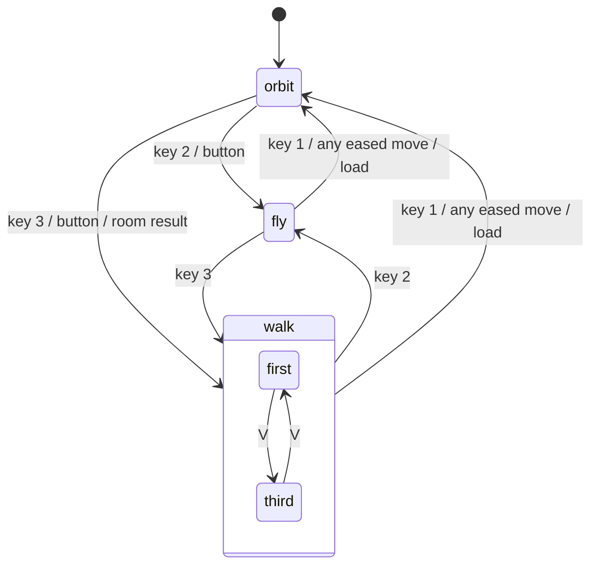
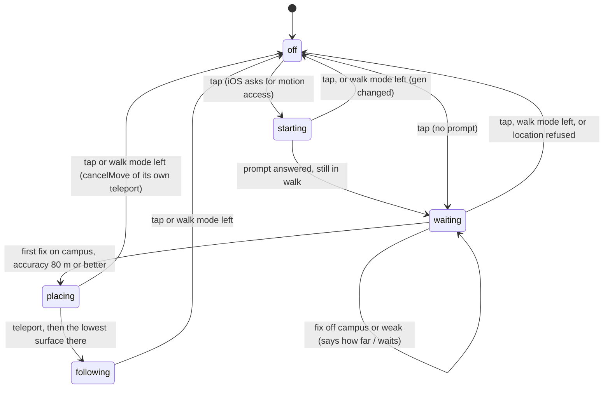
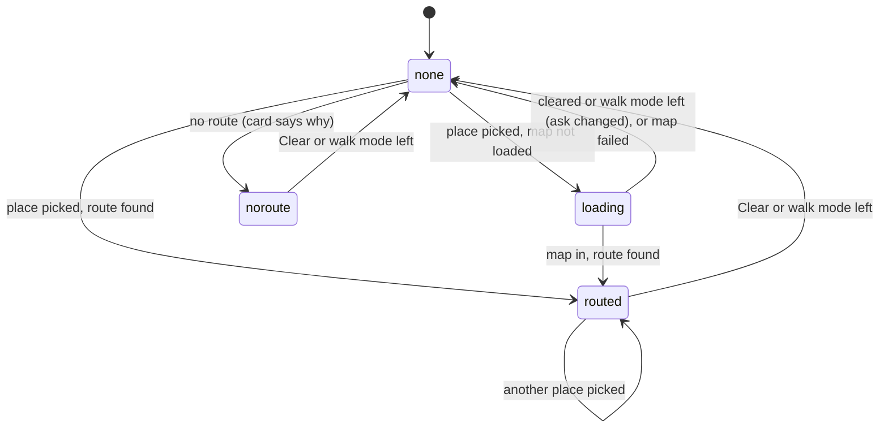
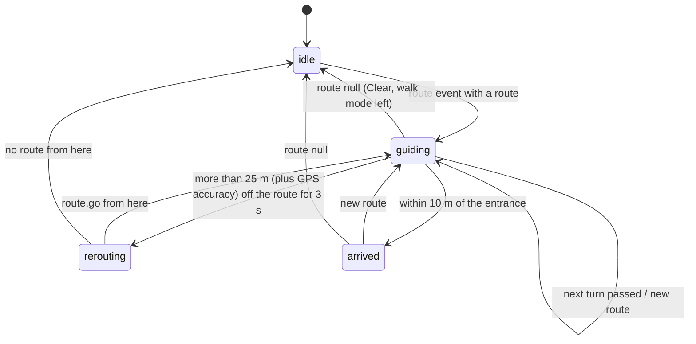
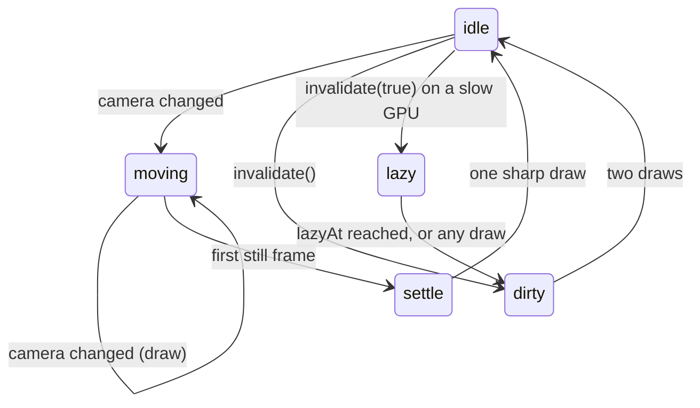
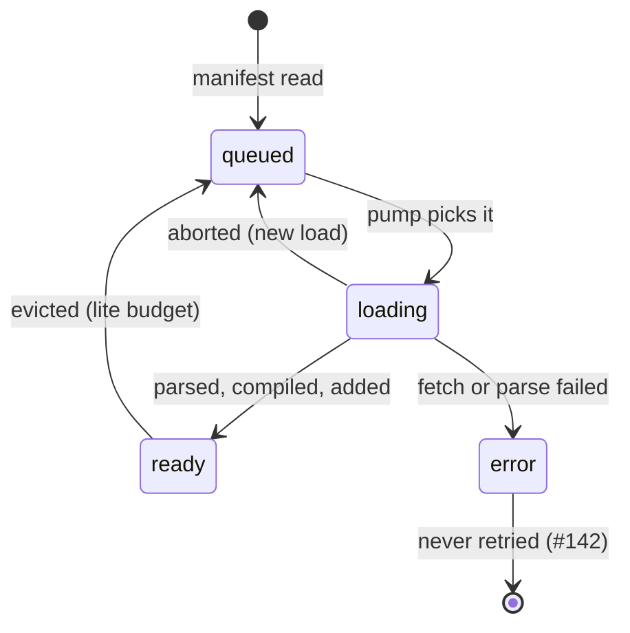
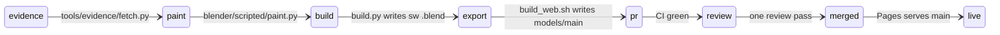
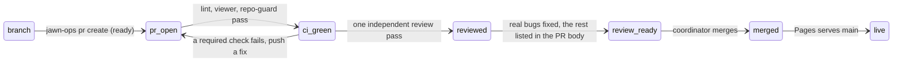

# State machines

How each flow in the viewer and the pipeline works now: its states, the events that move it, where the state lives and what happens on failure. Every line cites the code on `main`. A PR that changes one of these flows rewrites its section here in the same PR (AGENTS.md). This file describes the present only; git history holds the past.

Marks: **In flight (#n, owner)** names open work that is not on `main` yet. The mark goes when that work lands, and the section is rewritten to match.

Contents: [viewer](#viewer) (camera modes, view tools, frame loop, tile loading, interiors, labels and places, time and panels) · [pipeline](#pipeline) (scripted build, export, manifest, review and deploy, daily model release) · [implicit, duplicated and contradictory state](#implicit-duplicated-and-contradictory-state).

## Viewer

### Camera modes

Three navigation modes exclude each other: orbit, fly, walk. Walk has two views: first and third person.

- **State:** `app.state.mode` and `app.state.view` (`app.js:41`). `app.setMode` (`app.js:185-212`) keeps the copies in step: `controls.enabled`, the input module's own mode (`viewer/input.js:497`, `viewer/input.js:513`), `camera.near`, avatar visibility, and `document.body.dataset.mode` for the page (`viewer/ui.js:84`). The field of view eases to `FOV[mode]` (`app.js:35`) each frame.
- **Events in:** buttons and keys 1, 2, 3 (`viewer/ui.js:299`); V switches the walk view (`app.setView`, `app.js:213-216`); any eased move (`cam.flyTo` forces orbit, `viewer/camera.js:26`); a room search result (`goToRoom`, `app.js:171-179`, flies and then enters walk); `app.load` forces orbit (`app.js:222`); a share link (below).
- **Event out:** `mode { mode, view }` (`app.js:200`).

**Entering walk** (`app.js:201-211`): the spot is the `at` argument, else a pick at the screen centre (from orbit), else the orbit target or the camera. `player.teleport` (`viewer/player.js:127-146`) waits until the tiles there are in, builds collision and stands on the surface at or below the storey under the camera (`walkStartY`, `viewer/rooms-math.js:118`). It resolves `true` (standing), `false` (nothing to stand on) or `null` (a newer teleport or a mode change cancelled it). On `false`, `respawn` tries seven spots around `app.home` (`viewer/player.js:148-156`). Falling more than 60 m under the campus also respawns (`viewer/player.js:97`).

**Leaving for orbit** (`app.js:189-193`): the orbit target goes where the view points (a ray on built collision, else 60 m ahead), so the view does not jump.

**Eased moves and landing** (`viewer/camera.js`, `app.js:80-102`): one move at a time (`move`, `viewer/camera.js:9`). Pointer, wheel and touch on the canvas cancel it (`viewer/camera.js:17`); it resolves `false`. `app.flyTo` emits `fly { by }` first (`app.js:81`). With `land: true`, after arrival `land()` waits for the tiles and collision under the target and the camera, then applies `landPose`. Only a newer `fly` event (`landSeq`, `app.js:86-87`) or a mode other than orbit at the end (`app.js:97`) stops it ([#143](https://github.com/jamditis/campus-explorer/issues/143)).

**Share links** (`viewer/permalink.js`, `viewer/ui.js:176-203`): the hash holds mode, camera, target, time and labels. It is applied on `scene:ready` (`viewer/ui.js:55`) and on `hashchange` (`viewer/ui.js:203`); a fly or walk link sets the pose and then calls `setMode`. The hash is written 700 ms after the last camera, sun, mode or labels change (`viewer/ui.js:178`). The walk view (first or third) is not in the link.

**Follow me** (`viewer/follow.js`): in walk mode the phone's GPS and compass drive the walker.

- **State:** `active`, `starting` (the iOS motion prompt is open), `placing` (the first teleport is waiting for tiles), `placed`, `shown` (the view shows where the user is), `gen` (a token that every start and stop bumps), and `player.guide` (`{ x, z, look }`, `viewer/player.js`).
- **Events in:** the button (start or stop); geolocation fixes (`watchPosition`); orientation events; `mode` (leaving walk stops it); `fly` (a move to a place clears `shown` when not active).
- **Effects:** while `player.guide` is set, `player.step` glides toward it with no collision instead of reading the sticks; the compass sets `player.yaw` and `player.pitch` each frame. While `app.follow.private` (`active` or `shown`), `viewer/ui.js` writes no view into the address bar.

A late answer never starts anything: each await is followed by a `gen` check.

**Walking directions** (`viewer/route.js`, `viewer/route-math.js`): in walk mode "Go to a place" picks a place and routes from the walker (`player.guide` when follow me is on, else `player.position`) along `viewer/paths.json`.

- **State:** `graph` (the parsed path map, fetched on first use), `loading` (its promise, dropped on failure so the next try fetches again), `current` (`{ route, place, stepFree }` or null), `ask` (a token bumped by each request and by `clear`).
- **Events in:** a picked place (`go`); Clear; `mode` (leaving walk clears). A request that was cleared while the map loaded stops at its `ask` check.
- **Event out:** `route { route, place, stepFree }` or `route null`.

**Navigation display** (`viewer/nav.js`, `viewer/nav-math.js`): follows the `route` event.

- **State:** `nav` (`{ line, turns, place, stepFree, s, seg, along }` or null), `arrived`, `offSince` (when the walker first went off the route).
- **Each frame in walk mode:** progress along the route (`progress`, searched only up to 40 m past `s`), the walked part of the ribbon hidden (draw range), the card text and arrow updated five times a second.

**In flight (#119 and PR #140, a4k-ceopt; door leaves from the export, a4k-cebldg):** entrance doors that open for the walker in walk mode.

### View tools: tour, measure, film, hunt

Tour, measure and film each need orbit. Hunt runs beside any mode. Tour and measure stop each other, and film stops both when it starts, but measure started during film leaves both running: the measure handler stops only the tour, and film stays in orbit, so no `mode` or `fly` event stops it (the film keeps moving the camera while measure is on).

| Tool | State | Starts | Stops |
|---|---|---|---|
| Tour (`viewer/tour.js`) | `running`, `index`, `token`, `circling` (`:23-24`) | G or button: stops measure, forces orbit (`viewer/ui.js:233`) | Esc or a movement key (`:150-159`); pointer, wheel, touch (`:149`, `:162`); a non-orbit `mode` (`:160`); a `fly` not by `'tour'` (`:165`); an interrupted flight (`:95`); after the last stop it moves to the overview (`:100-103`) |
| Measure (`viewer/measure.js`) | `active`, `points` | R or button: stops the tour, forces orbit (`viewer/ui.js:232`) | Done button (`:106`); Esc with no points (`:223`); a non-orbit `mode` (`:231`) |
| Film (`viewer/cinema.js`) | `running`, `token`, `shot`, `t0`, `before` (`:19`) | N or button: stops tour and measure (`viewer/ui.js:235`); waits for a walker teleport, needs `scene:ready`, switches to orbit (`:75-93`) | pointer, wheel, touch (`:120-121`); Esc (`:122`); Stop button (`:27`); a `fly` not by `'cinema'` (`:125`); a non-orbit `mode` (`:127`, keeps the new mode); after the last shot (`:66-67`) |
| Hunt (`viewer/hunt.js`) | `active`, found set in localStorage (`:20`, `:85-89`) | button or H | button; a find counts only in walk (once standing) or fly (`:104-105`) |

Tour per stop: emit `place`, ask for its tiles, fly with `land`, hold (circle 7 s, or 5 s still with reduced motion), next (`viewer/tour.js:88-99`). `app.flyTo` resolves when the flight arrives, not when landing ends (`app.js:84`), so the hold starts while the landing step may still wait for tiles; a landing that finishes during the hold moves the target and camera under the circling. With no stops loaded it shows a toast and stays off (`:109`).

Film per shot (`viewer/cinema.js:45-68`): fade to black, ask for the tiles under the shot's camera and target until they are in or 5 s pass, set the light for the shot (minutes from the real sunset), then each frame put the camera on the eased pose (`onFrame`, `:70-73`). On stop it gives back the time, the panel and the pose and mode it started from (`:97-116`): fly looks from the old camera, walk stands where the walker stood.

The exclusion lives in the button handlers and in each tool's `fly` and `mode` listeners, not in one state ([#145](https://github.com/jamditis/campus-explorer/issues/145)).

### Frame loop

`requestAnimationFrame(loop)` runs on every tick (`app.js:274-299`). Each tick emits `frame`, steps the orbit controls or the player, clamps the view to the flight limit and eases the field of view. It draws only when one of these holds (`app.js:290`):

- **changed:** the camera matrix or projection differs from the last frame (`cameraChanged`, `app.js:264-272`). Emits `camera`.
- **settle:** the first still frame after motion: one full-resolution frame with fresh culling (`app.js:288`).
- **dirty:** a countdown set to at least 2 by `app.invalidate()` (`app.js:53-56`, `app.js:63`); each draw takes one off.

- **Lazy redraw:** `invalidate(true)` (a tile arrived, `viewer/world.js:148`) puts the redraw off to `lazyAt` when the smoothed frame time is over the slow threshold (`app.js:53-55`, `app.js:279`). Any draw clears it.
- **Idle:** `app.isIdle()` is true 400 ms after the last camera change (`app.js:59`). Collision warm-up and the minimap redraw wait for it (`viewer/hud.js:206`).
- **Who calls `invalidate`:** texture arrival and interior setup (`look.js`), sun and time (`app.js:117`), resize (`app.js:125`), mode and view (`app.js:200`, `app.js:215`), scenery refresh at most every 250 ms while the camera moves (`viewer/scenery.js:8`, `:161-170`), far-version swaps and evictions (`viewer/world.js`), teleport (`viewer/player.js:141`), measure edits.
- **Nothing draws forever on its own.** Water has no clock; the tour circles only while it holds at a stop; the film moves the camera only while a shot plays. While the camera moves, `govern` scales the drawing resolution down on a slow GPU and back up (`look.js:740-744`).

**In flight (lgn-cevista):** tree sway, an idle animation that will draw while the view is still. When it lands this section names the state that keeps the loop drawing and how it stops (hidden tab, reduced motion, quality).

### Tile loading

- **Run:** `world.load` (`viewer/world.js:344-384`). Each run takes a new `token` and `AbortController`; every async step checks the token and frees late results (`viewer/world.js:141`). The manifest is fetched with `no-cache` (`:348`); the lite profile leaves out `skirt.glb` (`:350`).
- **Per tile:** `tile.state` is `'queued'`, `'loading'` (`:128`), `'ready'` (`:142`) or `'error'` (`:152`). An evicted tile goes back to `'queued'` (`:306`) and emits `tile:gone` (`:308`).
- **Scene states:** `scene:start` (`:361`) → first batch, the skirts plus the 4 nearest tiles in parallel (`viewer/world.js:15`, `:364-366`) → `scene:ready` (`:369`) → stream the rest → `scene:complete` (`:381`) → far versions (`loadLods`, `:383`). If every first-batch tile fails, `load` throws and `app.load` emits `scene:error` (`:367`, `app.js:233`). `app.state.ready` and `app.state.complete` follow these events (`app.js:252`).
- **Order and concurrency:** 3 download loops (`PARALLEL`, `viewer/world.js:16`; `pump`, `:310-315`). `nextTile` (`:328-337`) takes urgent tiles first (`world.prioritize`), then `orderTiles` by distance to the focus and the view direction (`viewer/schedule.js:49`).
- **Data saver:** with `saveData` on, loading pauses after the first batch (`app.js:225`, `viewer/world.js:371-373`); only prioritized tiles load while paused. "Load the full campus" calls `world.resume()` (`viewer/world.js:536`).
- **Far versions (LOD):** after `scene:complete`, one at a time, nearest first (`loadLods`, `:238-269`). A failure waits 20 s, doubling to 5 min (`:217`, `:253-256`), on one shared timer (`retryLater`, `:222`); a download has a 60 s timeout where `AbortSignal.any` exists (`:218`, `:246`). `updateLods` (`:271-287`) shows a tile's far version and hides its full meshes when the full tile is not in memory or is farther than `LOD_DIST[quality]` (`:216`: 260, 420, 650 m).
- **Lite profile:** `app.lite` (`app.js:306`: phones, devices with 2 GB or less, or `?lite=1`) sets a budget of 9 centred tiles (`app.js:36`, `app.js:229`). `wanted()` (`viewer/world.js:292-302`) keeps the nearest budget plus slack, tiles without a far version and urgent tiles. After `scene:complete`, `rebalance` runs every 600 ms (`:382`) and evicts ready tiles outside the nearest budget + 2 (`:317-326`). `loadAll` drops the budget (`:386-392`) ([#141](https://github.com/jamditis/campus-explorer/issues/141)).
- **Shared files:** textures under `tex/` are loaded once per URL and sampler and counted per tile root (`createTextureShare`, `viewer/texshare.js:39`); freeing a tile skips shared textures. Geometry packs under `geo/` are buffer files that the loader fetches per tile.
- **Failure:** a full tile that fails stays `'error'`, and `isLoaded` counts it as loaded (`viewer/world.js:538`) ([#142](https://github.com/jamditis/campus-explorer/issues/142)).

**In flight (#136, a4k-ceopt):** generated files (manifest, `geo/`, `lod/`, tiles) out of git, and Pages built from an Actions workflow. When it lands, the deploy section below and the manifest source change.

### Interiors and the glass rule

- **Data:** `app.rooms` from `viewer/rooms.json` through `parseRooms` (`app.js:242`, `viewer/rooms-math.js:16`). `?interiors=0` or a failed fetch gives no volumes. `look.setInteriors(volumes)` (`app.js:244`, `look.js:902`) runs once per load.
- **Cull state:** in the cull pass (at most every 200 ms while moving, and on settle, `look.js:693`), `nearVolumes` finds the volumes within `INTERIOR_REACH` (40 m) of the camera (`look.js:696`, `viewer/rooms-math.js:6`, `:67`). Meshes whose centre lies in those volumes, grown by 1 m, skip the screen-size cull. The test uses the camera position, not the orbit target.
- **Glass rule:** decided once per mesh in `setInteriors`, not per frame. Glass whose box reaches into a grown volume gets its own material copy (`look.js:902-920`); per pixel, vertical glass inside the volume draws no fake rooms, and clear glazing (`isClearGlass`) is see-through from both sides with a Fresnel sky reflection and casts no shadow. Instanced clear window units inside a volume use a 22 % opacity copy (`look.js:995-1006`). Shell and roof always draw; glass is never solid for collision (`viewer/world.js`).
- **Interior light:** each material reaching into a volume gets a copy with an even indirect light inside the outline (`look.js:924-986`). No light objects, no extra draw calls.
- **Walk inside:** see "Entering walk". Room labels show in walk mode or with the camera inside a volume (`visibleRooms`, `viewer/rooms-math.js:91`).

### Labels and places

- **State** (`viewer/labels.js`): `visible` (localStorage `campus-labels`, `:37`, `:47`), `highlighted` (cleared after 6 s, `:19`, `:226`), and per label `hit`, `checks`, `found`, `nextTry`, `shown` (`:36`).
- **Anchor lookup** (`pump`, `:102-119`): a few ground lookups a frame on built collision only. A miss retries after a pause; a hit is confirmed several times before `found`. A new tile resets `nextTry` for labels not yet found (`:218`).
- **Layout** (`layout`, `:153`) runs on `camera` (`:220`) and on `frame` when something marked it dirty (`:228`). A label shows when it is in range (`inRange`, `viewer/labels-math.js:38`), on screen, not a place name while the camera is inside a volume (unless highlighted), and it survives `declutter` (`viewer/labels-math.js:53`). Room labels also need a clear line of sight (`sightPass`).
- **Places:** `app.places` is set before the `places` event. Search ranks with `searchPlaces` (`viewer/places.js:85`); a query with a digit also searches rooms. Choosing a result or clicking a label calls `app.goToPlace`: prioritize the tiles, emit `place`, `flyTo` with `land`.

### Time, sun and panels

- **Time:** `app.time = { date, preset }` (`app.js:44`). No clock runs: the time changes only through the time controls, "now", `[` and `]`, the film and share links. `app.setTime` emits `sun` and invalidates (`app.js:110-118`); the night sky, haze and lights follow the sun in `look.js`.
- **Panels:** the panel and help dialog keep their open state in the DOM (`hidden`, `open`). The minimap's on state is in localStorage `campus-map` (`viewer/hud.js:88`); it redraws only when idle (`viewer/hud.js:205-206`). Tools load after `scene:ready`; a tool that fails to load has its button disabled.

## Pipeline

### Scripted build (`blender/scripted`)

- **Run steps:** `blender/scripted/README.md:26-37`: evidence per area, paint sheets, `build.py` in Blender, then `SCENE=sw bash tools/web-export/build_web.sh`.
- **Areas:** `layout.areas()` takes every folder with a `footprint.json` or an `interior.json`, or the ones named in `--areas` (`layout.py:32-40`). Areas build in name order, except that `build_after` puts an area after the ones it names; a loop stops the run (`layout.py:57-68`).
- **Per area:** `build_area` (`build.py:63`), or `build_groundless` for interior-only areas (`build.py:44`). Shared edges take their heights from one `SEAM` object for the whole run (`build.py:29`, `:141-143`), so the order decides which area sets them. Areas with `adopt.json` copy objects from a pinned release `.blend`, checked by sha256; a missing path or a mismatch stops the run (`adopt.py:190-200`).
- **Output:** `build.py` refuses a path inside the repo (`build.py:177`) and saves once, after every area built (`build.py:195`): a failure in any area leaves the output untouched. With `--preview`, preview renders run after the save (`build.py:197`), so a preview failure exits with an error over a saved file.

### Export (`tools/web-export/build_web.sh`)

`set -u` with a `fail` step on each command (`build_web.sh:18-19`); a failed step exits 1. Stages:

1. **Gate** before every Blender start: no `.lock` from the hourly sessions, no other Blender, enough free memory (`gate`, `:36-39`). It only checks the locks; it does not take them. It waits with no time limit.
2. **Plan** (unless `SKIP_PLAN=1`): `plan_chunks.py` in Blender, then `make_chunks.py` (`:40-44`). The main run writes `source.txt` for the north run (`:45`).
3. **Prune** (full build): delete published and raw tiles that left the plan (`:47-57`).
4. **Export** each tile with `export_web.py` under the watchdog (`:58-67`).
5. **Per tile:** leaf tint, tree instancing, optimize, compact; far version to `lod/` for `t_` tiles.
6. **Land cover** (main, when its inputs exist), **supersede** (when any `sw_*.glb` exists, `:111`): cut other sources' ground under the scripted footprints; tiles cut under older rules stop the run (`supersede.mjs:494-497`).
7. **Shared files:** `share_tex` writes `tex/`, `share_geo` writes `geo/` (`:156-157`), `tree_points` adds tree stand-ins to the far versions (`:158-159`).
8. **Manifest** (`:160`), then the 95 MB check (`:161`).

Every stage writes into `models/main` in place; the manifest comes last ([#146](https://github.com/jamditis/campus-explorer/issues/146)).

### Manifest (`models/main/manifest.json`)

Written by `tools/web-export/manifest.py:58-77`: `tiles[]` (`file`, `bytes`, `center` for `t_` tiles, `lod`, `tex`), `paint`, `source_saved`, `source_version`, `sources`, `landcover`, `far_trees`, `hide`, `exported`, `tex` (shared file sizes), `total_bytes`. Read by `viewer/world.js` (tiles, hide, tex, lod), `app.js` (paint, landcover), `viewer/scenery.js` (landcover, far_trees) and `viewer/ui.js:46-50` (source snapshot line). Each export run rewrites the whole file; tile PRs regenerate it on the rebased branch.

### Review, merge and deploy

- **Checks:** `.github/workflows/ci.yml` runs `lint`, `viewer` and `repo-guard` on every PR and push to `main` (`ci.yml:3`, `:19`, `:44`, `:78`). `viewer` runs the unit tests and `tools/ci/check_viewer_refs.py` (`ci.yml:68`), which fails when the manifest names a file that is not there. `blender-smoke` and CodeQL run but do not gate.
- **Review:** one independent review pass per PR, by a model from a different provider than the author. Real bugs found in that pass are fixed in the same PR; other findings are listed in the PR body. No second verify round. Codex connector threads are handled per AGENTS.md rule 12.
- **Merge:** a PR is ready for merge when CI is green and the one review is done, at a named head SHA. The coordinator merges.
- **Deploy:** GitHub Pages serves the `main` branch as it is (`.nojekyll` at the root; no Pages workflow). A merge goes live a minute or two later. No step between merge and live checks the site.

**In flight (#136, a4k-ceopt):** Pages from an Actions workflow that builds the generated files.

### Daily model release

The `.blend` models are GitHub Releases, one a day, tagged `model-YYYYMMDD` (`README.md:40`). The hourly modelling sessions (Void, a Codex runtime outside the fleet; lgn-cemain stands in this week) own the main and north `.blend` and the release. The release steps are in the session runbooks (latest: `blender/montclair-state/scripts/ws268/RUNBOOK.md`, step 1, and `strip268.sh`): memory gate, strip imagery, check that no libraries or unpacked images remain, size check, sha256, then a manual `gh release create` with the file and `SHA256SUMS.txt`. The repo holds no automation for it; a routine after the evening session is open in `docs/ROADMAP.md:83`. The export checks the hourly sessions' lock files before each Blender start (`build_web.sh:30`, `:36-39`) but never creates them, so a session that starts after the check runs beside the export.

## Implicit, duplicated and contradictory state

Each line: what decides a state without naming it, where, and the issue.

| Kind | Where | What | Issue |
|---|---|---|---|
| Implicit | `app.js:306`, `viewer/world.js:293`, `viewer/scenery.js:98`, `:149`, `app.js:229`, `app.js:250` | The lite profile is two facts, `app.lite` and `world.budget`; `loadAll` changes only the second, so grass, skirt, disc and far trees stay in the lite state | [#141](https://github.com/jamditis/campus-explorer/issues/141) |
| Contradictory | `viewer/world.js:379-381`, `app.js:252` | In lite, `state.complete` is true with most tiles still queued | [#141](https://github.com/jamditis/campus-explorer/issues/141) |
| Implicit | `viewer/world.js:152`, `:331`, `:538` | `'error'` is a dead end, and `isLoaded` treats it as loaded | [#142](https://github.com/jamditis/campus-explorer/issues/142) |
| Implicit | `viewer/world.js:246` | The far-version timeout exists only where `AbortSignal.any` exists | [#142](https://github.com/jamditis/campus-explorer/issues/142) |
| Implicit | `app.js:86-87`, `app.js:97` | The landing step is a hidden sub-state of a move, cancelled only by `landSeq` | [#143](https://github.com/jamditis/campus-explorer/issues/143) |
| Duplicated | `viewer/hud.js:241`, `app.js:210` | Two rules for the height a walker lands at: minimap teleport takes the roof, mode entry takes the storey | [#144](https://github.com/jamditis/campus-explorer/issues/144) |
| Contradictory | `viewer/ui.js:232`, `viewer/cinema.js:125-127` | Measure started during film leaves both running | [#145](https://github.com/jamditis/campus-explorer/issues/145) |
| Implicit | `app.js:84`, `viewer/tour.js:93-96` | The tour hold starts while the landing step may still run | [#143](https://github.com/jamditis/campus-explorer/issues/143) |
| Implicit | `viewer/ui.js:232-235`, `viewer/tour.js:165`, `viewer/cinema.js:125`, `viewer/measure.js:231` | Which tool owns the view is spread over handlers and listeners | [#145](https://github.com/jamditis/campus-explorer/issues/145) |
| Contradictory | `build_web.sh:47-57`, `:160`; `supersede.mjs:482-497`; `README.md` "Refreshing the viewer" step 1 | The README says a failed tile stops the build before anything is published; the export writes in place | [#146](https://github.com/jamditis/campus-explorer/issues/146) |
| Implicit | `build_web.sh:39` | `gate()` waits on lock files with no limit and no message, and never takes the locks itself | [#146](https://github.com/jamditis/campus-explorer/issues/146) |
| Implicit | `build_web.sh:111` | Whether supersede runs depends on `sw_*.glb` existing | none: the sw tiles always exist while scripted areas do |
| Implicit | `manifest.py:55-57` | `hide` comes from north's `clip.json` if that file exists, else the old manifest | none: the north merge moves into main (ROADMAP "One scene") |
| Contradictory | `CLAUDE.md` viewer index vs `supersede.py:30`; `share_tex.mjs:5`; `blender/scripted/README.md:34`; `README.md:40` | Stale numbers, order and commands | [#147](https://github.com/jamditis/campus-explorer/issues/147) |
| Duplicated | `viewer/permalink.js:5`, `:69`, `:110-111` | A scene field (`s=main|north`) for a viewer with one scene | [#147](https://github.com/jamditis/campus-explorer/issues/147) |
| Implicit | `viewer/permalink.js:81`, `viewer/ui.js:197-199` | A link without `l` turns labels off and stores that | none: by design (`encodeView` writes `l=1` only when on) |
| Implicit | `viewer/ui.js:71-72` | The "tap again" confirmation is a DOM attribute and a 4 s timer | none: page-only, no other reader |
